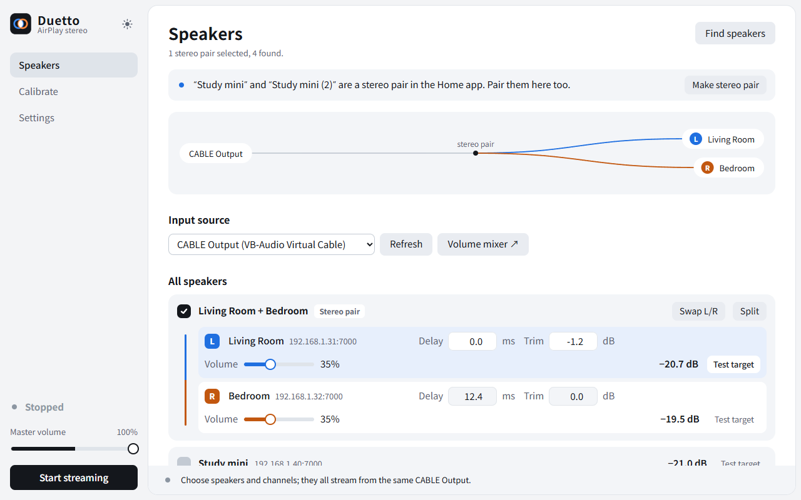
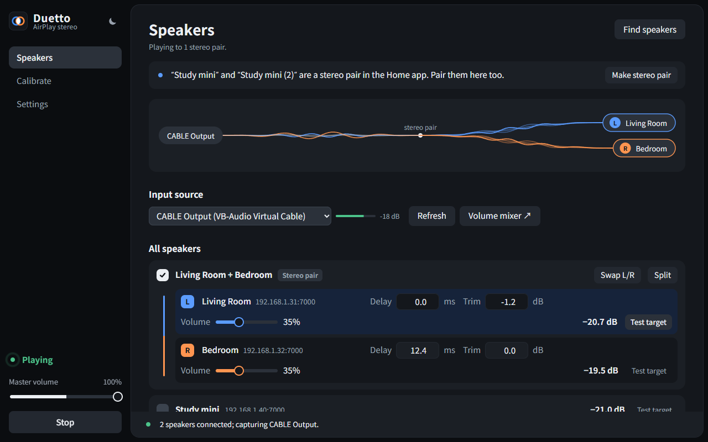
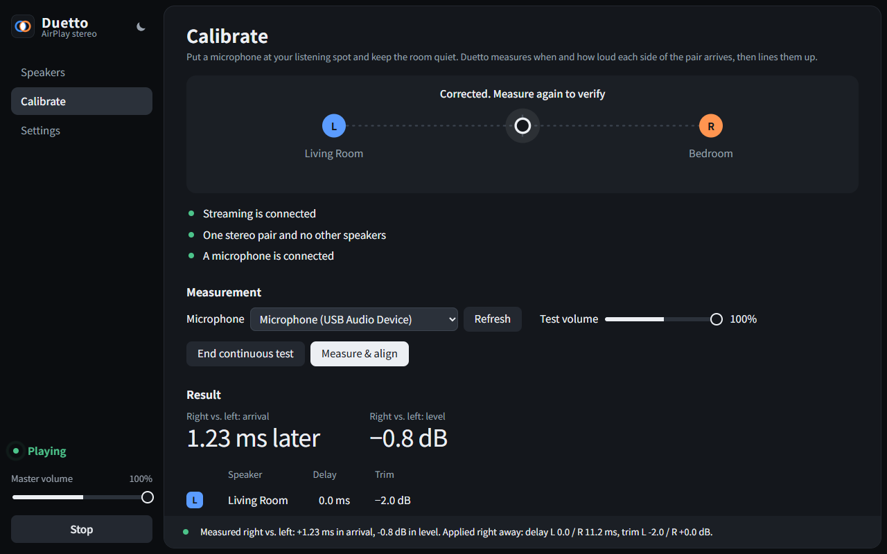
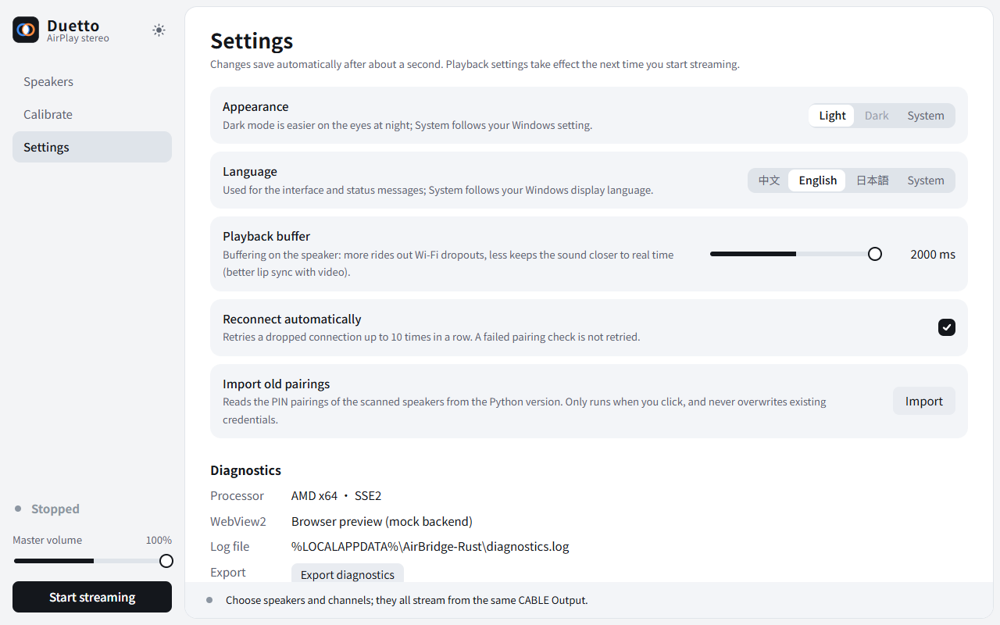

# Duetto

English · [中文](README.zh-CN.md)

Duetto streams Windows audio to AirPlay 2 speakers such as the HomePod. Two speakers can play as a left/right stereo pair, and a microphone calibrates their arrival time and loudness. It is a native Rust app that ships as a single EXE and needs no Python.

The interface is available in English, Chinese and Japanese.

## Interface

### Speakers



- **Route map.** Audio flows from CABLE Output to each speaker. A stereo pair's line splits into a blue (left) and an orange (right) branch. While playing, the lines become a Siri-style waveform whose height follows the input level, and fall flat when there is no sound.
- **Stereo pair card.** A pair shows as one card, and its two speakers are selected and played together. The pair can be swapped or split.
  - Each speaker has its own delay, level trim and volume.
  - Each speaker also shows its estimated output level.
- **Home app hint.** When the Home app already pairs two speakers, a banner offers to pair them here with one click.



While playing, the input level and dropped packet count appear next to the input source, and the sidebar shows the run state.

### Calibration



- Place a microphone at the listening position, start the continuous test, then press **Measure & align**.
- In about 20 seconds Duetto measures how much later and louder the right side arrives than the left, and applies the correction immediately.
- The marker at the top shows where the stereo image sits, estimated from how far both sides' delay and trim have moved from the last aligned point. It returns to the centre once the pair is aligned.
- Drag the marker (or use the arrow keys) to move the image by ear: it adds delay to and cuts level from the far side live, half of the shift from each. Double-click or press Home to return to the aligned point.

### Settings



The Settings page holds:

- the theme (light, dark or follow system);
- the language (中文, English, 日本語 or follow system), which also switches the status messages;
- the playback buffer (300–2000 ms);
- automatic reconnect;
- importing credentials from the old Python version;
- exporting diagnostics.

Changes save automatically after about a second.

## Requirements

- Windows 10 or 11 with the WebView2 runtime, which is built into Windows 11.
- The [VB-CABLE](https://vb-audio.com/Cable/) virtual audio device. Set the playing app's output to **CABLE Input**; Duetto captures from **CABLE Output**.
- AirPlay 2 speakers on the same local network.

## Usage

1. Run `airbridge-rust.exe` and press **Find speakers** on the Speakers page. If a speaker is not found, enter its IP at the bottom of the page.
2. Tick the speakers. To use two of them as left and right, press **Make stereo pair**.
3. The first connection needs pairing. On the speaker, press **Test target**, then **Pair with PIN**, and enter the 4-digit PIN the speaker shows.
4. Press **Start streaming** in the sidebar. The master volume scales all audio without touching any speaker's calibration.
5. To calibrate, tick a single stereo pair. Once bridging has run for 30 seconds, measure on the Calibration page, and measure again to verify.

## Model control (MCP)

`airbridge-rust.exe --mcp` is a stdio MCP server that drives the open Duetto window: `status`, `connect` (scan, then start streaming to the ticked speakers), `disconnect` and `set_volume` (master, or one speaker by name or address). The window listens on `127.0.0.1:47391` and accepts only these commands; pairing, delays and channels stay in the window. **Model control (MCP)** in Settings turns it off, shows the model's last action and copies the command below. To add it to Claude Code:

```
claude mcp add duetto -- "C:\path\to\airbridge-rust.exe" --mcp
```

## Data

All data lives in `%LOCALAPPDATA%\AirBridge-Rust`:

- `settings.json` holds the settings.
- `*.dpapi` files hold the pairing credentials, encrypted with DPAPI for the current Windows user.
- `diagnostics.log` is the diagnostics log. It never records credentials or audio.

## Build

The build needs Rust 1.92 or newer:

```bash
cargo test --release --locked
```

```bash
cargo build --release --locked
```

The page in `web/`, GSAP and the Noto Sans SC subset are embedded in the EXE at compile time, so rebuild after changing the page.

To work on the interface without the backend, open `web/index.html` from any static file server. It then loads `mock.js` as a fake backend.

`vendor/cidermill-airplay` is a patched local copy of the protocol library and must stay in place for the build.

## Limitations

- Speakers that require a connection password are not supported. Their card shows a notice.
- The two speakers run as independent sessions, so their clocks can drift. Sample-accurate sync over long sessions is not guaranteed.
- Multi-speaker playback and calibration have been tested only against simulated receivers. They are not yet verified on real HomePods, microphones and rooms.
