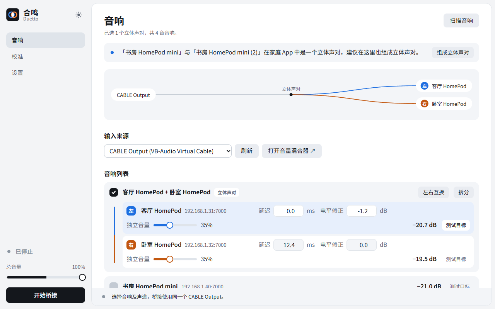
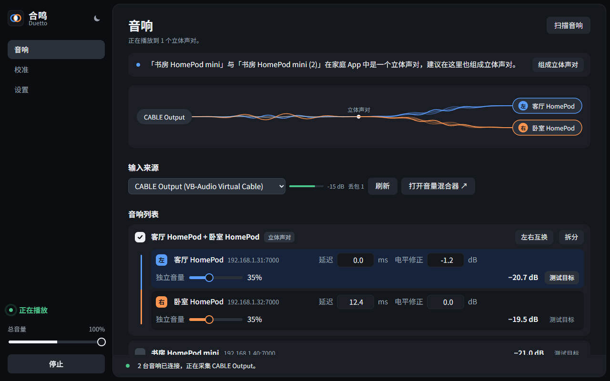
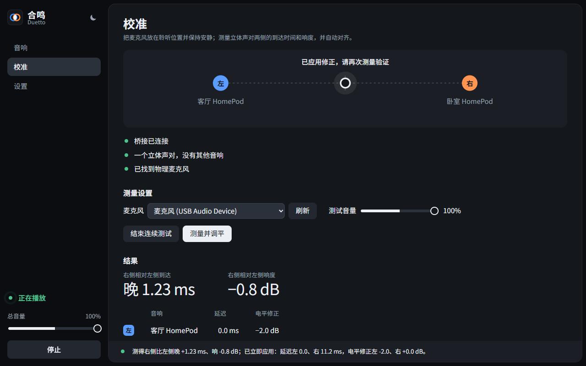
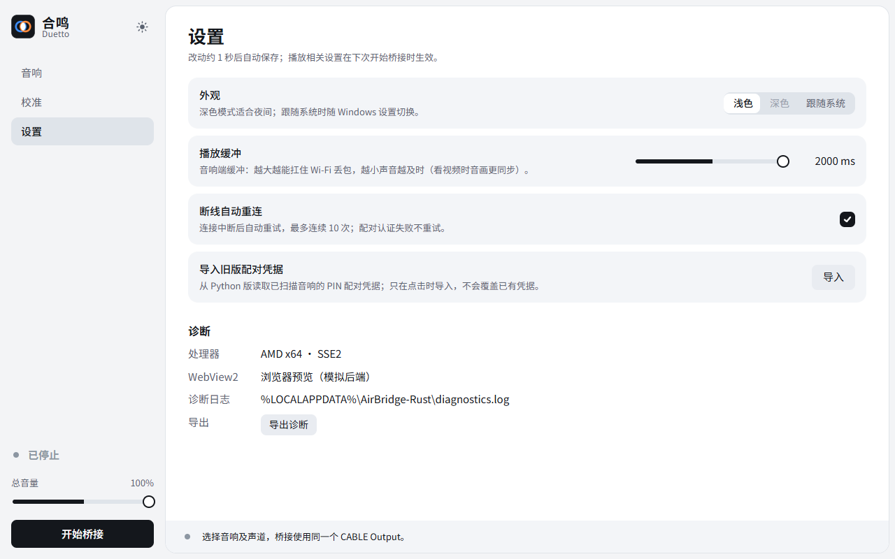

# 合鸣 Duetto

[English](README.md) · 中文

把 Windows 的声音推送到 AirPlay 2 音响（HomePod 等），两台音响可以组成一左一右的立体声对，再用麦克风校准两侧的到达时间和响度。原生 Rust 程序，单个 EXE，无需 Python。界面支持中文、英文和日文。

## 界面

### 音响



- **声音去向图**：从 CABLE Output 到各台音响。立体声对的线路在交汇点分成蓝（左）、橙（右）两路。播放时线路变成类似 Siri 的波形，起伏随输入电平变化，没有声音时恢复成直线。
- **立体声对卡片**：两台音响合成一张卡片，一起勾选、一起播放，可以「左右互换」或「拆分」。每台都可以单独设延迟、电平修正和独立音量，右侧显示估算的输出电平。
- **家庭 App 提示**：在家庭 App 里已经组成立体声对的两台，页面顶部会提示一键组对。



播放中，输入来源旁会显示 CABLE Output 的输入电平和丢包数，侧栏会显示运行状态。

### 校准



- 把麦克风放在听音位置，开启连续测试后点「测量并调平」。
- 测量约 20 秒，测出右侧相对左侧的到达时间差和响度差，修正值会立即生效。
- 上方的声像标记显示声音偏向哪一侧：按两侧延迟和电平修正相对上次对齐点的变化估算；对齐后标记回到中间。
- 拖动标记（或用方向键）可凭耳朵实时移动声像：给另一侧加延迟、降电平，各承担一半偏移。双击或按 Home 回到对齐点。

### 设置



设置页有这些选项：外观（浅色、深色、跟随系统）、语言（中文、English、日本語、跟随系统）、播放缓冲（300～2000 ms）、断线自动重连、导入旧版配对凭据和导出诊断。改动约 1 秒后自动保存。

语言切换立即生效，状态消息也会换成所选语言。日文界面使用系统自带的 Noto Sans JP（没有时用 Yu Gothic），汉字显示日文字形。

## 准备

- Windows 10/11，并已安装 WebView2 运行时（Windows 11 自带）。
- [VB-CABLE](https://vb-audio.com/Cable/) 虚拟声卡：先把要播放的应用输出设为 **CABLE Input**，本程序再从 **CABLE Output** 采集。
- 与电脑处在同一局域网的 AirPlay 2 音响。

## 使用

1. 启动 `airbridge-rust.exe`，在「音响」页点「扫描音响」。扫不到时，在页面底部手动输入 IP。
2. 勾选音响。用两台做左右声道时，点「组成立体声对」。
3. 首次连接需要配对：在该音响上点「测试目标」，再点「PIN 配对」，输入音响显示的 4 位 PIN。
4. 点左下角「开始桥接」。总音量按比例缩放所有声音，不会改动各台音响的校准值。
5. 校准时只勾选一个立体声对。开始桥接满 30 秒后，到「校准」页测量；可以再测一次复核。

更完整的流程和原理见 [双声道连接与校准流程](docs/双声道连接与校准流程.zh-CN.md)。

## 模型控制（MCP）

`airbridge-rust.exe --mcp` 是一个 stdio MCP 服务，控制已打开的 Duetto 窗口：`status`（状态）、`connect`（先扫描，再开始桥接已勾选的音响）、`disconnect`（断开）、`set_volume`（总音量，或按名称/地址设单台音量）。窗口在 `127.0.0.1:47391` 监听，只接受这几个命令；配对、延迟和声道仍只能在窗口里改。设置页的「模型控制（MCP）」可以关闭它、查看模型最近一次操作，并复制下面的命令。添加到 Claude Code：

```
claude mcp add duetto -- "C:\path\to\airbridge-rust.exe" --mcp
```

## 数据

数据都放在 `%LOCALAPPDATA%\AirBridge-Rust`：

- `settings.json`：设置。
- `*.dpapi`：配对凭据，用 Windows 当前用户的 DPAPI 加密。
- `diagnostics.log`：诊断日志，不记录凭据和音频。

## 构建

需要 Rust 1.92 或更新版本：

```bash
cargo test --release --locked
```

```bash
cargo build --release --locked
```

`web/` 里的页面、GSAP 和思源黑体子集在编译时嵌入 EXE，改了页面要重新构建。嵌入的字体只含界面用到的字，改了界面文字要重新裁剪（不重裁会有测试失败）：

```bash
uv run --no-project --with "fonttools[woff]" scripts/subset_font.py
```

在 `web/` 目录用任意静态服务器打开 `index.html`，会自动加载 `mock.js` 模拟后端，方便调界面。协议库 `vendor/cidermill-airplay` 是打过补丁的本地副本，构建时必须保留。

发布新版：先改 `Cargo.toml` 里的 `version` 并提交，再推送同名标签，GitHub Actions 会构建、测试并把 `Duetto.exe` 发布到这个标签的 Release：

```bash
git tag v0.1.1
```

```bash
git push origin v0.1.1
```

## 限制

- 不支持需要连接密码的音响；遇到这种音响，卡片上会显示提示。
- 两台音响是各自独立的会话，设备时钟可能漂移，不保证长时间的样本级同步。
- 多音响播放和校准只做过模拟测试，还没有在真实的 HomePod、麦克风和房间里验收。
